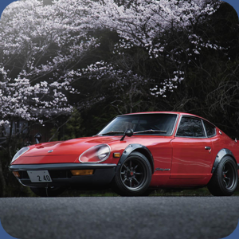

<div align="center">

# 🖼️ PhotoWidget

**Виджет-галерея для Rainmeter в стиле «Фото» из iOS**

Фотографии сменяют друг друга сами, а если взять фото мышью, оно уменьшится,<br>
на сером фоне появятся соседние кадры, и ленту можно листать за курсором.




<br>


</div>

---

## ✨ Возможности

-  **Автосмена фото** по таймеру (интервал настраивается)
-  **Эффект «нажатия»**: фото плавно уменьшается, за ним проявляется серый фон, сверху и снизу видны соседние кадры
-  **Лента следует за курсором** во время перетаскивания, а после отпускания плавно доезжает до ближайшего фото
-  **Жест-«бросок»**: быстрый свайп листает, даже если рука прошла короткое расстояние
-  **Колесо мыши** и **средняя кнопка** (пересканировать папку)
-  **Скруглённые углы** и аккуратная обрезка кадра под размер виджета
-  **Плавная анимация** без морганий: слоты меняются ролями, новое фото подгружается за кадром
-  **Любые имена файлов**, в том числе с кириллицей
-  Режим **случайного порядка**

## 🎬 Как это работает

Пока вы не трогаете виджет, он показывает одну фотографию на весь размер. Через Interval секунд она сама уезжает вверх, а на её место заезжает следующая.

Стоит зажать левую кнопку мыши, и фото плавно уменьшается примерно до трёх четвертей размера. За ним проявляется серый фон, а сверху и снизу выглядывают края предыдущего и следующего кадров. Так сразу видно, что фотографии можно листать.

Пока кнопка зажата, лента двигается за курсором. Если вы тянете вверх, фото уезжает вверх, а снизу поднимается следующее. Если вниз, наоборот. Скрипт при этом следит и за скоростью движения руки.

Когда вы отпускаете кнопку, скрипт решает, что делать дальше. Если вы потянули достаточно далеко или сделали быстрый «бросок», лента докатывается до соседнего фото. Если сдвиг был совсем небольшим, лента возвращается назад, и остаётся то же фото.

В конце фотография снова увеличивается до полного размера, серый фон исчезает, и виджет возвращается в спокойное состояние. Отсчёт времени до следующей автосмены начинается заново. Колесо мыши листает фото сразу, без перетаскивания.

## 📦 Установка

1. Установите [Rainmeter](https://www.rainmeter.net/).
2. Скачайте репозиторий(code -> download zip)
3. Скопируйте папку со скином сюда:

   ```
   %USERPROFILE%\Documents\Rainmeter\Skins\PhotoWidget\
   ```

   В ней должны лежать:

   ```
   PhotoWidget/
   ├── PhotoWidget.ini     # раскладка, настройки, действия мыши
   └── PhotoWidget.lua     # вся логика и анимация
   ```

4. Откройте `PhotoWidget.ini` и в блоке `[Variables]` укажите папку с фотографиями:

   ```ini
   Folder=C:\Users\ВашеИмя\Pictures\MyPhotos\
   ```

5. В Rainmeter нажмите **«Обновить всё»**, затем загрузите скин `PhotoWidget\PhotoWidget.ini`.

> Если всё прошло успешно, в журнале Rainmeter появится строка  
> `PhotoWidget: loaded photos: N`.

## 🎮 Управление

| Действие | Результат |
|---|---|
| Зажать левую кнопку мыши | Фото уменьшается, появляются соседние кадры |
| Тянуть вверх / вниз | Лента следует за курсором |
| Отпустить после сдвига | Фото листается к ближайшему кадру |
| Быстрый «бросок» вверх / вниз | Листает, даже если сдвиг короткий |
| Колесо мыши | Предыдущее / следующее фото |
| Средняя кнопка мыши | Пересканировать папку (новые фото подхватятся) |
| Ничего не делать | Через `Interval` секунд сменится само |

## ⚙️ Настройки

Все параметры лежат в секции `[Variables]` файла `PhotoWidget.ini`.

| Параметр | По умолчанию | Описание |
|---|---|---|
| `Folder` | — | Папка с фотографиями |
| `W`, `H` | `300` | Размер виджета в пикселях |
| `R` | `28` | Радиус скругления углов |
| `Interval` | `10` | Секунд между автосменой (`0` — выключить) |
| `ShrinkScale` | `0.72` | Размер фото в «нажатом» состоянии (72%) |
| `Gap` | `10` | Промежуток между кадрами в уменьшенном виде |
| `ShrinkTime` | `0.24` | Длительность уменьшения и возврата, сек |
| `SlideTime` | `0.42` | Длительность перелистывания, сек |
| `Threshold` | `35` | Минимальная длина свайпа в пикселях |
| `DragFollow` | `90` | «Резкость» слежения за курсором (больше — жёстче) |
| `Shuffle` | `0` | `1` — случайный порядок, `0` — по имени |
| `BgColor` | `58,58,60` | Цвет серого фона (R,G,B) |

Поддерживаемые форматы: `jpg`, `jpeg`, `png`, `bmp`, `webp`, `gif`.

## 🧠 Под капотом

- **Список файлов.** Плагин `RunCommand` в скрытом режиме запускает `dir` и сохраняет результат в `files.txt` рядом со скином. Lua читает файл и оставляет только изображения.
- **Анимации.** Lua считает кадры по времени (а не по числу обновлений), поэтому скорость не зависит от нагрузки на систему. Уменьшение, сдвиг и возврат идут внахлёст, а смена фото использует мягкое «S-образное» сглаживание.
- **Слежение за курсором.** Rainmeter не сообщает координаты мыши при движении, поэтому поверх виджета лежит 75 тонких невидимых полосок. Каждая сообщает скрипту, когда курсор въехал в неё (`MouseOverAction`). По ним скрипт восстанавливает положение и скорость курсора.


## 🛠️ Решение проблем
**В НАЗВАНИИ ФОТО НЕ ДОЛЖНО БЫТЬ РУССКИХ БУКВ**
| Сообщение в журнале | Что делать |
|---|---|
| `no images found in: …` | Проверьте `Folder`: в папке должны быть изображения поддерживаемых форматов |
| `cannot open files.txt (scan failed)` | Не отработал `dir`. Проверьте путь в `Folder` и права на запись в папку скина |
| `scan timed out` | `RunCommand` не завершился за 8 секунд. Проверьте, что плагин не заблокирован антивирусом |
| Фото не движется за курсором | Проверьте версию Rainmeter и откройте issue с логом |

> ℹ️ Полоски слежения за курсором рассчитаны на высоту виджета около 300 px.  
> Если делаете `H` заметно больше (примерно от 370 px), между полосками могут появиться щели.

## 🤝 Вклад

Pull request'ы и идеи приветствуются. Если нашли баг, откройте issue и приложите:

- версию Rainmeter (вкладка «Версия» в окне Rainmeter);
- строки из журнала (вкладка «Лог»);
- что именно вы делали в момент проблемы.

## 📄 Лицензия

[MIT](LICENSE)